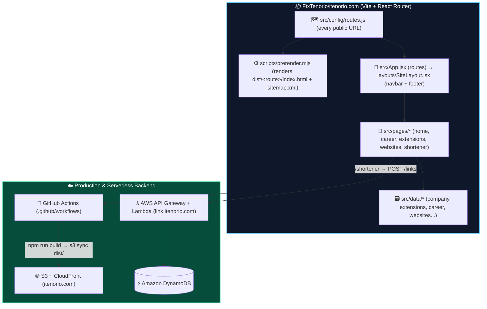

<div align="center">
 
  <!-- ================= HERO BANNER (VENOM NEON) ================= -->
   

  <!-- ================= TYPING SVG ================= -->
  <a href="https://itenorio.com">
    
  </a>

  <br/>

  <!-- ================= STATUS & TECH BADGES ================= -->
  <p align="center">
    <a href="https://itenorio.com" target="_blank">
      
    </a>
    
  </p>

  <!-- ================= QUICK NAVIGATION PILLS ================= -->
  <p align="center">
    <a href="https://itenorio.com" target="_blank">
      
    </a>
    <a href="https://itenorio.com/extensions" target="_blank">
      
    </a>
    <a href="https://itenorio.com/shortener" target="_blank">
      
    </a>
  </p>

</div>

---

### ⚡ What is `itenorio.com`?

**`itenorio.com`** is the website of **iTenorio Tech** (ITENORIO TECH DESENVOLVIMENTO DE SOFTWARE LTDA, CNPJ 68.333.521/0001-02) — a React + Vite single-page app that serves as the company home with **Crunchyroll Navigator** as the featured product, my career page (`/career`), a showcase for browser extensions, and a web client for my serverless utilities.

<table align="center" width="100%">
  <tr>
    <td width="55%" valign="top">
      <h4>🔥 Core Highlights</h4>
      <ul>
        <li><b>One SPA, static-host friendly:</b> <code>react-router</code> routes in <code>src/App.jsx</code>; a tiny Vite plugin emits one <code>index.html</code> per route (listed in <code>src/config/routes.js</code>) so S3 + CloudFront serve every URL directly.</li>
        <li><b>Dynamic Extension Preview Cards:</b> Interactive showcase rendering live metadata, previews, and store links for my browser tools (such as <i>Crunchyroll Navigator</i>).</li>
        <li><b>Serverless Link Shortener Client:</b> Dedicated <code>/shortener</code> route integrated with my AWS Serverless backend (Lambda + API Gateway + DynamoDB) to mint short links under <code>link.itenorio.com</code>.</li>
        <li><b>SEO-ready static output:</b> every route is pre-rendered to real HTML at build time, with per-page metadata, Open Graph images and schema.org JSON-LD.</li>
      </ul>
    </td>
    <td width="45%" valign="top">
      <h4 align="center">🛠️ Built With</h4>
      <div align="center">
        <br/>
        
        <br/><br/>
      </div>
      <pre lang="diff">
+ React Router SPA + per-route static HTML (Vite)
+ Automated CI/CD via GitHub Actions
+ Zero-bloat Fast Refresh & ESLint
+ Interactive 3D/Visual Easter Eggs</pre>
    </td>
  </tr>
</table>

---

### 🖥️ Live Ecosystem & Route Previews

> 💡 *Click any card below to jump straight into the live route in production:*

<table align="center" width="100%">
  <tr>
    <td width="33%" align="center" valign="top">
      <h4>🏠 1. Company Home</h4>
      <a href="https://itenorio.com" target="_blank">
        <!-- DICA: Se quiser usar um print local da pasta public, troque o src abaixo por "./public/nome-da-imagem.png" -->
        
      </a>
      <p align="left">
        <b>Route:</b> <code><a href="https://itenorio.com">itenorio.com/</a></code><br/>
        iTenorio Tech company page: featured product (Crunchyroll Navigator), services, founder and contact/legal details. My résumé lives at <code><a href="https://itenorio.com/career">/career</a></code>.
      </p>
    </td>
    <td width="33%" align="center" valign="top">
      <h4>🧩 2. Extensions Hub</h4>
      <a href="https://itenorio.com/extensions" target="_blank">
        <!-- DICA: Você pode trocar o src abaixo pela imagem da extensão na sua pasta public/ ou src/ -->
        
      </a>
      <p align="left">
        <b>Route:</b> <code><a href="https://itenorio.com/extensions">/extensions</a></code><br/>
        Dedicated showcase featuring dynamic extension preview cards, enhanced layouts, and direct Chrome Web Store integrations.
      </p>
    </td>
    <td width="33%" align="center" valign="top">
      <h4>🔗 3. URL Shortener App</h4>
      <a href="https://itenorio.com/shortener" target="_blank">
        <!-- DICA: Você pode trocar o src abaixo por um print do shortener da sua pasta public/ -->
        
      </a>
      <p align="left">
        <b>Route:</b> <code><a href="https://itenorio.com/shortener">/shortener</a></code><br/>
        Sleek frontend interface for creating instant, low-latency short URLs powered by AWS Lambda & DynamoDB.
      </p>
    </td>
  </tr>
</table>

---

### 🧠 System Architecture & Routing Flow

> *How a single repository powers the portfolio, the extensions catalog, and the serverless shortener interface:*



---

### 📂 Repository Anatomy

```text
itenorio.com/
├── .github/workflows/        # 🚀 CI/CD: build + sync dist/ to S3, invalidate CloudFront
├── public/                   # 🎨 Static files copied as-is (favicons, robots.txt)
├── index.html                # The only HTML template (meta filled in per route at build)
├── vite.config.js            # Vite + React + Tailwind
├── scripts/prerender.mjs     # After the build: pre-renders dist/<route>/index.html, 404.html, sitemap.xml
└── src/
    ├── main.jsx              # Browser entry: hydrates the pre-rendered HTML
    ├── entry-server.jsx      # Build-time entry used by scripts/prerender.mjs
    ├── App.jsx               # All routes (react-router)
    ├── config/routes.js      # Every public URL + its <title>/description/share image
    ├── config/structuredData.js # schema.org JSON-LD per route
    ├── layouts/SiteLayout.jsx# Navbar + footer + page meta + scroll handling
    ├── components/
    │   ├── layout/           # Navbar, Footer, Logo
    │   └── ui/               # Section, PageLoader
    ├── pages/
    │   ├── home/             # /            company home (sections/)
    │   ├── career/           # /career      résumé (components/)
    │   ├── extensions/       # /extensions, /extensions/:slug, …/crunchy-navigator/privacy-policy
    │   ├── websites/         # /websites
    │   ├── shortener/        # /shortener   (talks to link.itenorio.com)
    │   └── NotFoundPage.jsx
    └── data/                 # Content: company, extensions, websites, career, tech stack…
```

**Adding a page:** create it under `src/pages/<name>/`, add a `<Route>` in `src/App.jsx` and an entry in `src/config/routes.js` (so the build creates `dist/<name>/index.html`).

---

### 🚀 Running Locally in 30 Seconds

<div align="center">
  
</div>

```bash
# 1. Clone the repository
git clone https://github.com/FtxTenorio/itenorio.com.git
cd itenorio.com

# 2. Install dependencies
npm install

# 3. Spin up the Vite development server with HMR
npm run dev

# 4. Build for production (outputs dist/, one pre-rendered index.html per route)
npm run build

# 5. Serve the production build locally
npm run preview
```

---


<div align="center">
  

  <details>
    <summary><sub>⚡</sub></summary>
    <sub>Crafted with ☕ in England 🏴󠁧󠁢󠁥󠁮󠁧󠁿 · Rooted in Brazil 🇧🇷</sub>
  </details>
</div>
